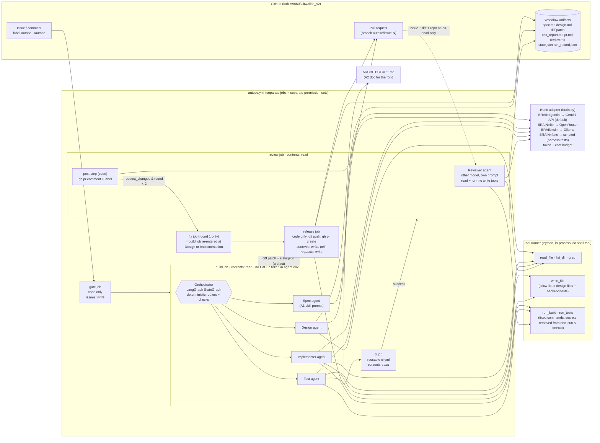

# Component view — GitCore

The editable diagram is in [`component_view.drawio`](component_view.drawio). It is adapted from the LangGraph orchestrator diagram of my earlier SpecBridge project. The Mermaid version below renders on GitHub.

## Who calls what

| Component | Kind | Calls | Can write to repo? | Holds which secret? |
|---|---|---|---|---|
| gate | code | GitHub REST (via `gh`) to check sender permission, comment | no | `GITHUB_TOKEN` (issues: write) |
| Orchestrator (`graph.py`) | code (LangGraph) | stage nodes, `checks.py`, `state.py` | local checkout only | none |
| Spec agent | LLM | brain only (no tools: it must not read code, see A1 skill R7 "do not design") | no | none (key stays in the brain process) |
| Design agent | LLM | brain + read-only tools + ARCHITECTURE.md | no | none |
| Implementer agent | LLM | brain + read/write tools + run_build/run_tests | local checkout, allow-listed paths only | none |
| Test agent | LLM | brain + read tools + write (tests only) + run_tests | `backend/tests/**` only | none |
| release | code | `git push`, `gh pr create/edit` | yes (branch `autose/issue-N`, never `main`, never merge) | `GITHUB_TOKEN` (contents + PR write) |
| ci | reusable workflow | `npm ci && npm run build && npm test` | no | none |
| Reviewer agent | LLM (different model) | brain + read-only tools + run_tests | no | none |
| post step | code | `gh pr comment`, `gh pr edit --add-label` | no (PR comments only) | `GITHUB_TOKEN` (pull-requests: write) |

The OpenRouter key exists only inside the Python process that calls the brain. `run_build` and `run_tests` start child processes with an environment that has `OPENROUTER_API_KEY`, `GITHUB_TOKEN`, `GH_TOKEN` and `ACTIONS_*` removed, because those processes execute LLM-written code.
