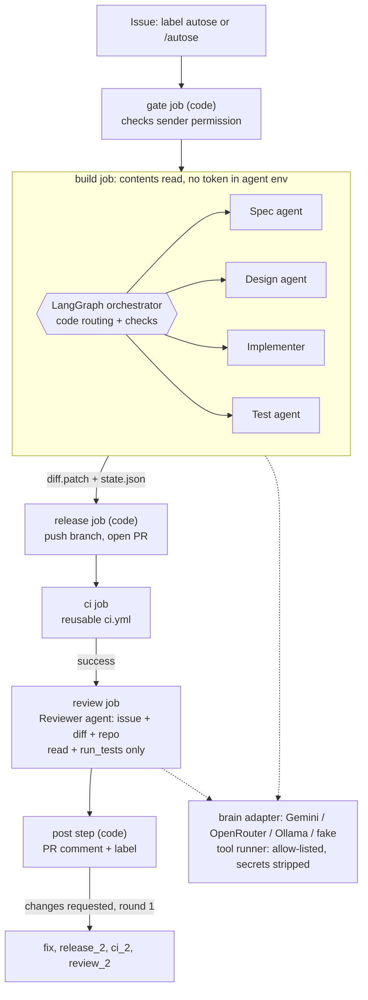
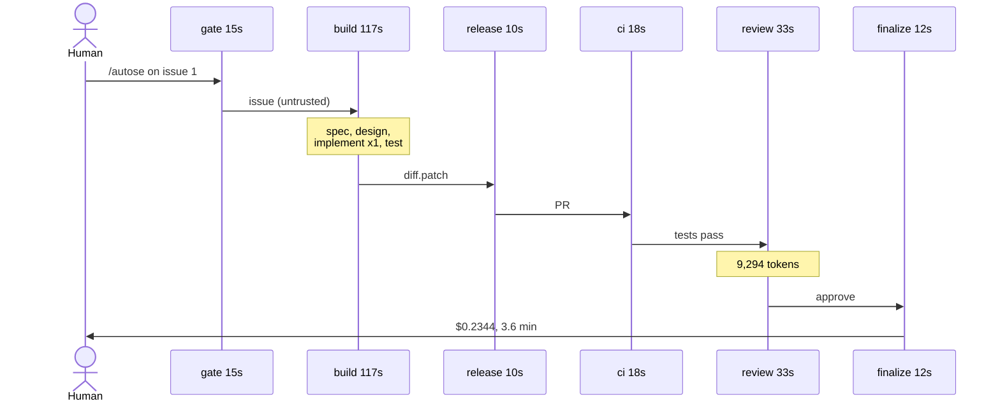

<!--
Source of report.pdf. Every number here comes from results/results.csv, results/runs.md or the
run comments on the fork. Build: see report/README note in the final message (build_report.js).
-->

# 1. Architecture

**System.** GitCore runs in the fork of GitWallah (https://github.com/H9660/Gitwallah_v2, a Node/Express + React app for practising Git). A maintainer adds the `autose` label or comments `/autose`. GitHub Actions jobs then take the issue through six SDLC stages and stop at a reviewed PR; the merge stays with a human. All runs reported here used Gemini through its API (ADR-011), with `gemini-3.5-flash-lite` for the four builder agents **and** for the reviewer (see §3 and §6 for what that means for ADR-008).

**Shape.** Three ideas, each tied to an ADR:

1. *Agents only where judgement is needed* (ADR-001). Four builder agents (Spec, Design, Implementer, Test) and one Reviewer. Gate, Release, every stage check and every routing decision are plain code.
2. *Routing by code, inside jobs split at permission boundaries* (ADR-002, ADR-005). Stages 1–4 are a LangGraph `StateGraph` inside the `build` job, which has a read-only token and is the only place builder models run. The `release` job holds the write token and runs no model. The reviewer has its own job.
3. *Artifacts, not conversations* (ADR-003, ADR-004). Agents hand over JSON (`spec.json`, `design.json`) that code validates and renders as `spec.md`, `design.md`, `diff.patch`, `test_report.md`, `pr.md`, `review.md`, plus `state.json`.

Figure 1 — Component view (full version with the per-component secret table: <code>architecture/views/component_view.md</code>). Jobs marked "(code)" run no model; agents never hold a write token.

**Table 1 — Stage map: which agent handles each stage** (full version: `architecture/views/stage_map.md`).

| # | Stage | Agent | Job (token) | Artifact | Check (decided by code) |
|---|---|---|---|---|---|
| 1 | Requirements | Spec agent (A1 skill prompt, no tools) | build (read) | spec.md/json | every AC has given/when/then, an exact expected value and `verify_by`; no ambiguity-lexicon words; no safety flag |
| 2 | Design | Design agent (read-only tools, ARCHITECTURE.md) | build (read) | design.md/json | listed files exist, listed functions found in them, every AC mapped to a change and a test file |
| 3 | Implementation | Implementer (writes only design files + tests) | build (read) | diff.patch | `npm run build` passes; diff non-empty; only allowed paths changed |
| 4 | Testing | Test agent (writes tests only) | build (read) | test_report.md | `npm test` passes; each AC id named in a passing test; no test removed or skipped |
| 5 | Release | code | release (write) → ci (read) | pr.md + PR | PR open; reusable CI job succeeded. A failed run opens a **draft** PR instead (ADR-012) |
| 6 | Review | Reviewer (own job, own prompt) | review (read; post step PR write) | review.md/json | verdict parsed; approval needs tool evidence; changes → fix job (round 1 only) |

Back-edges: tests fail → Implementation (≤ 3 attempts) → one redesign → stop. A reviewer `approach` finding goes back to Design, a `code`/`tests` finding to Implementation. At most two review rounds, enforced by the job graph.

Figure 2 — Sequence view of the real run <a href="https://github.com/H9660/Gitwallah_v2/actions/runs/45383631388">45383631388</a> (B1 → PR #4): all stages passed with one implementation attempt; the reviewer approved with 0 findings; 129,655 tokens in total. Job durations from the Actions API. The fix path (fix → release_2 → ci_2 → review_2) was not needed in any recorded run.

# 2. Design decisions

**Table 2 — all ADRs** (full text in `architecture/decisions/`).

| ADR | Decision | Option chosen | Main option rejected | Main reason | Status |
|---|---|---|---|---|---|
| 001 | Splitting the work | 4 builders + 1 reviewer; glue in code | one agent for everything | no self-grading, small contexts, least privilege | Accepted |
| 002 | Control flow | LangGraph state machine, code routing, jobs at permission boundaries | LLM planner | bounded, reproducible loops | Accepted |
| 003 | Hand-offs | validated JSON artifacts, minimum context | full transcripts | no error propagation; checkable | Accepted |
| 004 | State | state.json + per-job artifacts; branch/PR/labels across runs | artifacts on the PR branch | clean diff; resumable | Accepted |
| 005 | Tools | allow-listed in-process tools, no shell; `gh` only in model-free jobs | GitHub MCP / bash tool | a hijacked agent cannot push or read secrets | Accepted |
| 006 | Models | cheap builder, different-vendor reviewer, one adapter | one strong model | cost; reviewer diversity | Superseded by 011 |
| 007 | Checks | code checks per stage; LLM judge only at review | LLM judge per stage | reproducible, cannot be argued with | Accepted |
| 008 | Reviewer independence | own job, other model, issue+diff+repo only, evidence-required approval | same model with full artifacts | judges the request, not the builder's story | Accepted (partly tested, E1) |
| 009 | Safety and failures | layered budgets, untrusted tags, no secrets where model code runs | prompt guardrails only | worst case is a bad diff | Accepted |
| 010 | Triggers | label or `/autose` from write-access users; queue per issue | any commenter | budget abuse; duplicate PRs | Accepted |
| 011 | Models (revised) | Gemini API direct for all roles; per-role model variables | OpenRouter as the only provider | first real run stopped on prepaid OpenRouter credits | Accepted |
| 012 | Failures (revised) | a failed run opens a draft PR with partial code and failure details; reviewer skipped | stop comment only | failed runs were opaque and unmeasurable (F2) | Accepted |

## 2.1 The three decisions that mattered most

**(a) ADR-007, checks in code.** Every stage check is a function over a structured artifact, so the stage that did the work never decides whether it passed. This shaped the other decisions: it is why hand-offs are JSON (ADR-003), why the A1 skill's testability rules became a mechanical lint, and why test tampering can be detected by counting tests per pre-existing file. It worked in both directions in the runs. On F2 the design check rejected a design that named a "function" called `setInterval cleanup timer`, which does not exist in any file; without the check the implementer would have been sent to change code that is not there. Its weakness also showed: on V1 every code check passed (the AC-named tests passed), but the hidden test `H-V1-3` (an unparsable date is rejected) fails on the PR. A test named after an AC proves the AC id was mentioned, not that the requirement was covered. That gap is what the reviewer and the hidden tests are for (§4).

**(b) ADR-005 + ADR-009, permissions follow the job, not the prompt.** Model-written code runs during `npm test`, so any process that runs it must hold no secret worth stealing. The build and review jobs have a read-only token that never enters the agent environment; child processes get an environment with API keys and GitHub tokens removed; `persist-credentials: false` keeps the token out of `.git/config`. The only job that can push runs no model. Prompt-level defences (untrusted-issue tags, safety flag) are a second layer, not the boundary. The cost is more jobs and a release step that re-applies `diff.patch` on a fresh checkout. In all five recorded issue runs that re-apply worked first time (release 5/5), so the split cost run time (about 10 s per release job) but no failures.

**(c) ADR-008, reviewer independence.** The reviewer runs in its own job, sees only the issue, the diff and the repository, must list ways the change could be wrong and check each with a tool, and cannot approve without evidence; code turns an evidence-free approval into "request changes". The verdict is a comment plus a label, and branch protection keeps the human approval. In practice only the *context* half of this decision was in force: `MODEL_REVIEWER` and `MODEL_BUILDER` were both set to `gemini-3.5-flash-lite`, so the default reviewer was the builder's model. E1 (§3) shows what the context-independent reviewer caught, and that a stronger reviewer model did not fix its main blind spot.

# 3. Decision experiments

Variants are switched by repository variables or `workflow_dispatch` inputs only (`experiment/variants.md`), so the workflow file is identical across variants. Not every planned variant was run; the tables say so where a cell has no data.

**E1 — ADR-008 reviewer independence.** Planned: E1-A (reviewer on the builder model, also seeing `design.md` and `test_report.md`) against E1-B (independent context, different model). Run: the default configuration (independent context, *same* model as the builder) on all five seeded PRs (1 correct, 4 planted defects, all green in CI) and on the four issue PRs that got a review; and E1-C (independent context, stronger model `gemini-3.8-flash`) on sp5, the one seeded PR the default reviewer got wrong, with the same diff, prompt, tools and budgets. E1-A was not run.

| Measure | E1-A informed, same model | Default: independent context, same model (flash-lite) | E1-C: independent, stronger model (3.8-flash) |
|---|---|---|---|
| Planted defects caught | not run | **3 of 4** (sp2 skipped test, sp3 fail-open + rewritten test, sp4 removed `requireAuth`) | sp5 only: **0 of 1** |
| False alarm on sp1 (correct PR) | not run | 0 of 1 (approved) | – |
| Issue PRs approved that fail hidden tests | not run | 1 of 4 (V1, hidden 3/4) | – |
| Tool calls on sp5 | – | 1 | 6 |
| Reviewer tokens per review (issue PRs) | – | mean 7,744 (5,123–11,256) | not recorded |

*Result.* The context-independent reviewer gave the expected verdict on 4 of 5 seeded PRs and raised no false alarm. Its findings named the right file and category each time (e.g. "Removed `requireAuth` middleware from the `DELETE /:id` contest route"). The miss is informative: sp5 returns `expiresAt` as epoch seconds where the issue asks for an ISO 8601 string, duplicates the 30-minute TTL and weakens the tests. E1-C looked much harder (six tool calls, including `server.js` and the callers of `getInfo`) and its evidence even *states* "Unix epoch seconds" and "relaxed from `toEqual` to `toMatchObject`", yet it approved. Both reviewers' one-line restatement of the issue had already dropped the format requirement. A stronger model added investigation, not judgement; the "list risks, show evidence" rule did not help when the risks were checked against the wrong requirement. The V1 miss has the same shape: the PR fixes the end-before-start case, and the reviewer did not check what else "it shouldn't let you break things" covers, such as an unparsable date.

*Design change.* ADR-008 stays Accepted, but its "different model" claim is untested and its evidence rule needs a requirement side. Planned change (not yet run): the reviewer prompt lists every concrete requirement from the issue (formats, values, names, rejection cases) as a checklist and must mark each one against the diff before any verdict; a missing item forces `request_changes`. E1-A and a true different-vendor reviewer are still needed to answer the original question.

**E2 — ADR-006/011 builder model.** E2-A is the cheap builder (`gemini-3.5-flash-lite`) on the five issues. E2-B (a stronger builder) was not run, for two reasons:
- **High demand.** The stronger Gemini models were often overloaded. Calls were refused (`RESOURCE_EXHAUSTED`), as happened to F2's review job even on the default setup.
- **Quota and budget.** A full builder run makes many model calls, and the free-tier quota and the course budget could not cover five stronger-model runs.

The one stronger-model run that was possible was a single review (E1-C, `gemini-3.8-flash` on sp5), because a review needs far fewer calls than a build.

| Measure | E2-A cheap builder (flash-lite) | E2-B stronger builder |
|---|---|---|
| Issues reaching an open PR (of 5) | 5 (final runs) | not run |
| Implementation attempts / redesigns | 1 / 0 on every issue | not run |
| Hidden tests passed (of 20) | 19 | not run |
| Reviewer approvals (round 1) | 4 of 4 reviewed (F2: review job failed, quota) | not run |
| Tokens / USD per issue | mean 154,122 / $0.268 | not run |
| Wall time per issue | mean 3.5 min (3.1–4.0) | not run |

*Result.* On these five small issues the cheap model was good enough once it produced output: one attempt each, no redesign, 19/20 hidden tests. Its cost was in *operability*, not quality: F2 failed three runs at the design stage because the model spent the output limit on hidden thinking (empty reply) and then tried native function calls that the text protocol does not declare (`MALFORMED_FUNCTION_CALL`). *Design change:* the brain adapter now re-asks with a doubled output limit (8,192 → 16,384) and a corrective message, the design prompt requires function names that appear in the file, and failed runs open a draft PR so they can be measured (ADR-012). After these changes F2 passed every stage with one implementation attempt.

# 4. Results

All numbers below come from `results/results.csv` (final run per issue, default variant).

| Stage | Passed / reached | Notes |
|---|---|---|
| 1 Requirements | 5 / 5 | V1 (vague) did not ask for clarification; the PR implements end-before-start validation |
| 2 Design | 5 / 5 | F2 needed three earlier runs and the harness fixes in §3 |
| 3 Implementation | 5 / 5 | 1 attempt each, 0 redesigns |
| 4 Testing | 5 / 5 | |
| 5 Release (PR + CI) | 5 / 5 | CI success on every PR |
| 6 Review | 4 approve, 1 error | F2's review job failed with `RESOURCE_EXHAUSTED` (Gemini quota); no fix rounds were triggered |

Earlier attempts not in the table: two B2 runs stopped at stage 1 on configuration errors (missing API key, OpenRouter prepaid credits — the reason for ADR-011), and three F2 runs stopped at stage 2 as described in §3.

**Hidden tests** (20 in total, run on each PR head by `run_hidden.ps1`): B1 **4/4**, B2 **4/4**, F1 **5/5**, F2 **3/3**, V1 **3/4** (fails `H-V1-3: an unparsable date is rejected`). The full existing suite (140 passed, 18 skipped) stayed green on every PR.

**What the reviewer caught, and where it was wrong.** Caught: sp2 (test switched to `it.skip`), sp3 (judge errors fail open, with the test rewritten to match), sp4 (`requireAuth` removed from contest delete). Correctly approved: sp1, B1, B2, F1. Wrong: sp5 (approved a spec mismatch, with either model) and V1 (approved a partial fix). No false alarms. Every wrong verdict was an approval, which is the expensive direction for a gate that a human relies on.

**MERGE_READINESS_CHECK** (CI passed, final review approved, all hidden tests pass):

| Issue | PR | CI | Final review | Hidden | Merge-ready |
|---|---|---|---|---|---|
| B1 | #4 | success | approve | 4/4 | **yes** |
| B2 | #3 | success | approve | 4/4 | **yes** |
| F1 | #6 | success | approve | 5/5 | **yes** |
| F2 | #15 | success | none (review job error) | 3/3 | no |
| V1 | #14 | success | approve | 3/4 | no |

Total cost of the five recorded issue runs: **770,611 tokens, $1.34** (builder 739,636 + reviewer 30,975 tokens). The seeded reviews, the second sp5 review and the earlier failed runs are not included because their usage was not recorded, so this is a lower bound.

# 5. Hindsight

If I started again tomorrow, I would first change **how I chose the models (ADR-006, revised in ADR-011)**. I fixed one cheap model up front and made the model a configuration switch, but I did not measure early where a small model is good enough, and in the end the same switch quietly made the reviewer the builder's model, which removed half of ADR-008. The runs show the stages differ: the cheap model was good enough to write correct code for every issue, but it was fragile at producing structured output (the three F2 design failures) and it was not a strong enough judge as a reviewer. Even a stronger reviewer missed sp5, so the model alone is not the fix. Starting with a per-stage trial on the five issues, with the reviewer pinned to a different vendor from day one, would have shown where a cheap model is enough (spec, implementation on small changes), where output robustness matters more than raw quality (design), and that the reviewer needs a requirement checklist more than a bigger model. It would also have made each stage's cost visible before the rest of the design was fixed.

# 6. Limitations and threats to validity

1. **Small sample.** Five issues and five seeded PRs in one repository, one recorded run per issue and one review per seeded PR. LLM output varies between runs, so every difference in §3 is indicative, not significant.
2. **Planned comparisons were not run.** E1-A and E2-B have no data, and E1-C covers one PR. The stronger models were in high demand and often refused calls (`RESOURCE_EXHAUSTED`), and API quota and budget limits ruled out repeating every issue on them. The default reviewer used the builder's model, so the "different model" part of ADR-008 was never in force in the default runs; reviewer results confound context independence with model choice.
3. **The hidden tests and seeded PRs were written by the same people (with AI help) who built the pipeline.** They may share its blind spots. The tests were checked to fail on the baseline and pass with a reference fix, which shows they are achievable, not that they are complete.
4. **The code checks are shallow.** "AC id in a passing test name" does not prove the test checks the AC (V1), and the ambiguity lexicon is a word list. Stage pass rates overstate quality; the hidden tests are the real measure.
5. **Incomplete cost data.** Review comments on the seeded PRs carry no token footer, and failed runs before ADR-012 are not in `results.csv`; the reported cost is a lower bound.
6. **Infrastructure noise.** One review failed on API quota and three runs failed on model output quirks of a preview model; Gemini model codes and behaviour change over time, which limits reproducibility of the exact numbers.
7. **Model-written code runs on the runner with network access** during `npm test`. Secrets are not in its environment, but the runner is not network-isolated (ADR-009). The pipeline was evaluated only on backend changes; GitWallah has no frontend tests.

# Appendix

- **A. Runs and artifacts.** Every run, PR and review comment is linked in `results/runs.md`. Example of a complete run: B1, run [45383631388](https://github.com/H9660/Gitwallah_v2/actions/runs/45383631388), [PR #4](https://github.com/H9660/Gitwallah_v2/pull/4) (PR body = rendered spec and design; review comment on the PR; `spec.md`, `design.md`, `test_report.md` in the run's `gitcore-build` artifact).
- **B. Seeded-PR reviews.** sp1 [#10](https://github.com/H9660/Gitwallah_v2/pull/10), sp2 [#9](https://github.com/H9660/Gitwallah_v2/pull/9), sp3 [#8](https://github.com/H9660/Gitwallah_v2/pull/8), sp4 [#11](https://github.com/H9660/Gitwallah_v2/pull/11), sp5 [#12](https://github.com/H9660/Gitwallah_v2/pull/12) (two reviews: flash-lite and 3.8-flash). Planted defects and expected verdicts: `experiment/seeded_prs/labels.json`.
- **C. Prompts:** `workflow/autose/prompts/`. **Experiment definitions:** `experiment/variants.md`. **Local verification before the first run:** `results/local_verification.md`.
